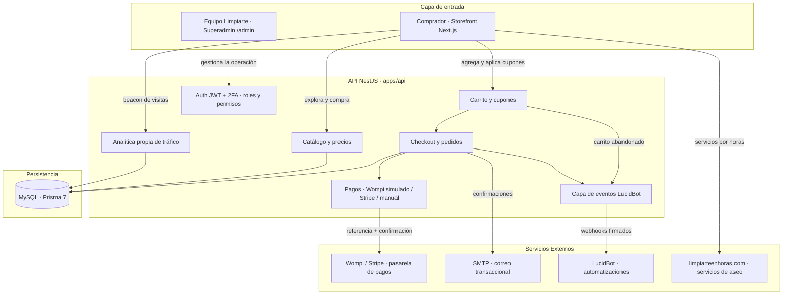

# Limpiarte E-commerce × Limpiarte SAS

Monorepo de la plataforma de comercio electrónico de Limpiarte SAS: tienda en línea de productos de aseo con pago 100% digital, panel de administración (Superadmin) con roles y permisos, e integración por eventos con LucidBot. Backend en NestJS 11 (TypeScript) con Prisma 7 sobre MySQL, frontend en Next.js 16 con Tailwind CSS 4, desplegado en Hostinger con base de datos vía `DATABASE_URL`. El objetivo de negocio es habilitar un canal de venta propio 24/7 para la línea de productos, independiente de los servicios de aseo por horas que continúan en limpiarteenhoras.com.

---

## 🗺️ Arquitectura de la Experiencia

El comprador navega el catálogo, arma su carrito y paga en línea; el equipo de Limpiarte opera todo (catálogo, pedidos, clientes, contenido y automatizaciones) desde el Superadmin, y cada evento del negocio se publica hacia LucidBot para disparar automatizaciones conversacionales.



---

## 🔍 En qué consiste el Fullstack

Monorepo pnpm con dos aplicaciones desacopladas: `apps/api` (REST API NestJS con prefijo `/api/v1`, Swagger en `/docs`) y `apps/web` (Next.js App Router que sirve el storefront público y el Superadmin en `/admin`). El modelo de datos vive en `apps/api/prisma/schema.prisma` (~45 modelos) con cliente Prisma generado en `src/generated/prisma`.

### 📄 Módulos Principales

1. **Catálogo (`apps/api/src/modules/catalog/`)**:
   - CRUD completo de productos con variantes (opciones/combinaciones), imágenes, ficha técnica, FAQs, relaciones (venta cruzada), etiquetas y SEO; categorías jerárquicas y marcas; carga masiva por CSV.
   - Ficha tipo marketplace: viñetas «Sobre este artículo», especificaciones por grupo (`ProductSpec`, las `isKey` alimentan la tabla principal), medidas, garantía, videos MP4 (`ProductVideo`), documentos PDF (`ProductDocument`), bloques de contenido visual del producto y de la marca (`ProductContentBlock`) y muestras de color o miniatura por valor de opción. Las marcas tienen logo, banner, descripción, lema, estado y orden (`PUT /admin/catalog/brands/:id`).
   - Guardar un producto **sincroniza** opciones y variantes por id o por combinación de valores (`product-variants.sync.ts`): nunca las borra y recrea, conserva imagen, precio anterior, peso, estado, carritos, listas de precios e inventario, y solo elimina lo que se quitó (queda en auditoría y el editor pide confirmación si la combinación tenía stock, carritos o precios por volumen). El stock se guarda como ajuste sobre lo que el formulario cargó, con su movimiento de inventario, así que una venta hecha mientras alguien edita no se pierde; y `Product.version` rechaza con 409 el guardado de un formulario desactualizado.
   - En el producto, la clave ausente conserva el valor y `null` (o texto vacío) lo limpia: aplica a SKU, descripción, ficha técnica, SEO, garantía y medidas, así que vaciar un campo en el editor sí lo borra. El API acepta cuerpos JSON de hasta 1 MB solo en `/api/v1/admin/catalog/*` con sesión (`useBodyParser` en `main.ts`), para que un producto con todas sus secciones llenas quepa; el resto de endpoints, incluidos los públicos, conserva el límite de 100 kB.
   - `GET /catalog/products/:slug/recommendations` arma en una sola pasada las ofertas relacionadas (por mayor descuento real), los productos relacionados y las marcas de la categoría.
   - Promoción **pague N, lleve N+1** (2x1, 3x2 o 4x3) que se aplica de forma repetida por presentación: la unidad regalada no se cobra pero sí se despacha y se descuenta del inventario. Costo unitario por producto para ver el margen en el panel, nunca expuesto en la tienda.
   - Sección «Modo de uso» con imagen, video o PDF, y banners propios del producto arriba y abajo de la ficha.
   - Endpoints públicos con búsqueda, filtros combinables (categoría, marca, precio, stock, promoción), ordenamiento y precios efectivos (promos con vigencia y listas de precio) resueltos por `pricing.service.ts`.

2. **Carrito y Checkout (`apps/api/src/modules/cart/`, `orders/`)**:
   - Carrito persistente por token de sesión y fusión automática al iniciar sesión; cupones con restricciones y validación de vigencia/usos; estimador de envío por zona.
   - **Interfaz optimista**: el contador sube al instante y la imagen del producto vuela hasta el carrito (Web Animations API); las respuestas fuera de orden se descartan por secuencia. Del lado del servidor las mutaciones construyen la vista desde memoria en vez de recargar el carrito, lo que bajó el tiempo del endpoint de 4,7 s a ~1 s.
   - **Checkout de tres pasos** (entrega → envío → pago) con resumen de compra fijo: exige sesión de cliente (validado también en el backend, `POST /checkout` devuelve 401 sin token), permite elegir entre direcciones guardadas o fijar una nueva en un **mapa Leaflet/OpenStreetMap** que guarda coordenadas en la dirección y en el pedido.
   - Cálculo de envío por zonas con umbral de envío gratis, facturación empresarial (NIT), snapshot de ítems, numeración `LP-AAAAMMDD-XXXXXX` y máquina de estados del pedido con historial auditado.

3. **Pagos (`apps/api/src/modules/payments/`)**:
   - Abstracción `PaymentGateway` con **Wompi** como pasarela principal en **modo simulado**: página de pago de prueba con PSE/Nequi/tarjeta y aprobación o rechazo controlados. La simulación exige que no haya llave privada y que el entorno no sea producción (en producción se activa solo con `WOMPI_SIMULATION=true`); si no aplica, el pago cae a Stripe o al flujo manual, nunca a una pasarela sin cobro. Stripe queda como alternativa y existe fallback manual.
   - Al confirmarse el pago: descuento automático de inventario con movimientos trazables, redención de cupón, correo de confirmación y eventos `PAYMENT_APPROVED`/`ORDER_STATUS_CHANGED`.

4. **Conversión y prueba social (`apps/api/src/modules/catalog/engagement.service.ts`, `apps/web/components/store/`)**:
   - Reseñas verificadas por compra y preguntas públicas con moderación en el panel; alertas "avísame cuando llegue" con correo automático al reponer; boletín con captura vía popup de bienvenida.
   - Botón de carrito flotante y persistente con el total y el número de productos, que abre el drawer desde cualquier pantalla de la tienda.
   - Badges reales en tarjeta (−% OFF, más vendido por ventas de 30 días, nuevo, últimas unidades), rating con estrellas, favoritos, drawer de carrito con complementarios, barra de progreso de envío gratis, autocompletado del buscador, order bump en checkout y feed XML para Google Merchant.
   - **Ficha de producto con estructura de marketplace** (`apps/web/app/(store)/producto/[slug]/`, componentes en `apps/web/components/store/product/`): galería con miniaturas verticales, zoom al pasar el cursor y vista completa con pestañas Videos / Imágenes / Documentos (teclado y deslizamiento); columna central con marca enlazada, calificación, precio partido con descuento, selector de variantes con miniatura o color y precio por valor (preselecciona la primera variante con stock y cambia la imagen), tabla de atributos clave y «Sobre este artículo»; caja de compra fija con fecha estimada de entrega (zona America/Bogota, sin desajustes de hidratación), envío a la dirección guardada del cliente, cantidad, «Agregar al carrito», «Comprar ahora», enviado y vendido por, devoluciones, soporte y «Agregar a favoritos». Debajo: carruseles «Ofertas en productos relacionados» y «Productos relacionados con este artículo» (scroll-snap, «Página N de M»), «Desde la marca», «Descripción del producto», «Información del producto» en acordeones de dos columnas, videos, documentos PDF, preguntas frecuentes, opiniones, preguntas y «Marcas de esta categoría». JSON-LD con marca, especificaciones, ofertas por variante y `VideoObject`.

5. **Superadmin (`apps/web/app/admin/`)**:
   - **Tablero como central de métricas**: un solo filtro (rango de fechas con presets o personalizado + segmentos por ciudad, categoría, marca y canal) gobierna todos los indicadores, y cada uno muestra su variación contra el período anterior equivalente.
   - Ventas: ingresos, compras, ticket promedio, unidades, evolución diaria comparada, rankings por producto, categoría y ciudad, pedidos por estado.
   - Tráfico web con **analítica propia** (sin Google Analytics ni terceros): visitantes únicos, sesiones, páginas vistas, conversión real sobre sesiones, origen del tráfico (directo, orgánico, social, referido, campañas UTM), páginas más visitadas, productos más vistos y dispositivos.
   - Clientes: nuevos, recurrentes, carritos abandonados y valor potencial. Alertas operativas de despacho, pagos rechazados e inventario bajo.
   - Gestión de productos, pedidos (estados, guía y transportadora, notas internas, reenvío de correos, exportación CSV), clientes/CRM con etiquetas y exportación, cupones, contenido (banners, páginas legales, blog, menús), zonas de envío, usuarios/roles y auditoría.
   - **Editor de producto por secciones** (navegación fija arriba y botón de guardar fijo abajo): imágenes con texto alternativo y orden, videos MP4 con barra de progreso y póster, documentos PDF por tipo, variantes con muestra de color o miniatura por valor (las combinaciones se recalculan solas y conservan sus ids, así que guardar no borra carritos, precios por volumen ni inventario), «Sobre este artículo», especificaciones por grupo, medidas, garantía, contenido visual con vista previa y productos relacionados con buscador.
   - **Marcas** (`/admin/marcas`): logo, banner, lema, descripción, orden, estado y bloques de contenido «Desde la marca»; el borrado pide confirmación sostenida y se bloquea si la marca tiene productos.
   - **Subida de archivos propia**: cada campo de imagen acepta archivo o URL externa. Los archivos se guardan en el disco del API (`apps/api/uploads/`, servido en `/uploads` con soporte de rangos para video) con validación de formato y de magic bytes y nombres aleatorios: imágenes hasta 5 MB (`POST /admin/uploads`), PDF hasta 10 MB (`POST /admin/uploads/documents`, firma `%PDF-`) y MP4 hasta 50 MB (`POST /admin/uploads/videos`, caja `ftyp`, escrito en disco y no en memoria); en productos se pueden subir varias imágenes a la vez.

6. **Integraciones (`apps/api/src/modules/integrations/`, `/admin/integraciones`)**:
   - Credenciales de Claude (Anthropic) y de Meta Ads administradas desde el panel, cifradas con AES-256-GCM en la base y nunca devueltas: la pantalla solo indica si existen. Cada una se puede activar, desactivar y probar contra el servicio real, y el resultado queda con fecha y mensaje de error.

7. **Usuarios, roles y permisos (`apps/api/src/modules/users/`, `roles/`, `common/guards/`)**:
   - Login administrativo con contraseña + segundo factor por correo, bloqueo por intentos fallidos y cierre de sesión por expiración de JWT.
   - RBAC con 14 permisos y 6 roles sembrados (Administrador, Gestor de catálogo, Gestor de pedidos, Servicio al cliente, Marketing, Auditor), overrides por usuario, tope de 15 usuarios internos activos y Superadmin único.

8. **Integración LucidBot (`apps/api/src/modules/lucidbot/`)**:
   - Conexión asistida desde el Superadmin (URL de webhook + clave cifrada AES-256-GCM, prueba de conectividad, indicador de estado) sin intervención técnica.
   - 9 eventos activables individualmente (carrito abandonado con temporizador, pedido creado, pago aprobado/rechazado, cambios de estado, despacho, entrega, cliente registrado, solicitud de contacto), log histórico con reintentos automáticos cada 10 minutos.

### 🧩 Servicios Destacados

* **`apps/api/src/common/guards/auth.guard.ts`**: guard global que resuelve el principal (staff o cliente) desde el JWT y calcula el set de permisos efectivos (rol + overrides) en cada petición.
* **`apps/api/src/modules/catalog/pricing.service.ts`**: única fuente de verdad del precio efectivo (base, variante, promoción con ventana, listas de precio por volumen); lo consumen catálogo, carrito y checkout.
* **`apps/api/src/modules/orders/orders.service.ts`**: orquesta el ciclo de vida del pedido (transiciones válidas, inventario, cupones, correos y eventos LucidBot) en transacciones Prisma.
* **`apps/api/src/modules/mail/mail.service.ts`**: correo transaccional vía SMTP con plantillas editables desde el Superadmin y variables `{{placeholder}}`.
* **`apps/api/prisma/seed.ts`**: siembra permisos, roles del contrato, cuenta Superadmin, eventos LucidBot y settings base.
* **`apps/web/lib/cart/cart-context.tsx`**: estado global del carrito en el storefront con token persistido en `localStorage` y fusión invitado → cliente.

---

## ⚡ Por qué es Necesario

Hoy la venta de productos de Limpiarte depende de canales conversacionales y gestión manual; no existe un canal transaccional propio donde el cliente pague en línea sin intermediación.

1. **Canal de venta autónomo 24/7**: el cliente explora, compara, agrega al carrito y paga sin intervención del equipo comercial.
2. **Operación centralizada**: catálogo, inventario, pedidos, despachos, clientes y contenido se administran desde un único panel sin depender del desarrollador.
3. **Automatización del embudo**: cada evento (carrito abandonado, pago, despacho, entrega) llega a LucidBot para recuperación de ventas, notificaciones y campañas de recompra.

---

## 💎 Qué aporta a Limpiarte SAS (Valor Agregado)

* **Reducción de carga operativa**: la selección, el pago y el seguimiento de pedidos pasan del chat a la plataforma; el equipo solo prepara y despacha.
* **Autonomía total del negocio**: precios, promociones con vigencia, cupones, banners y textos legales se editan desde el Superadmin sin tocar código.
* **Trazabilidad y control**: bitácora de auditoría de acciones críticas, historial de estados por pedido, movimientos de inventario con motivo y responsable, y roles con mínimo privilegio.
* **Base escalable**: arquitectura desacoplada (API + web), modelo normalizado con migraciones versionadas y pasarela de pagos intercambiable — crece en referencias y volumen sin rediseño.
* **Cumplimiento Ley 1581 de 2012**: registro de consentimiento de términos y tratamiento de datos por cliente, consultable desde el CRM.

---

## 🛠️ Stack y Comandos

- **NestJS 11** (API REST, TypeScript estricto) · **Next.js 16** + **React 19** (storefront y Superadmin) · **Tailwind CSS 4** (estilos) · **Prisma 7** + `@prisma/adapter-mariadb` (MySQL vía `DATABASE_URL`) · **Wompi** (pasarela simulada) y **Stripe 22** (alternativa) · **Nodemailer** (SMTP transaccional) · **Leaflet** (mapa de entrega) · **pnpm 11** workspaces (Node ≥ 22).

```bash
pnpm install                                 # instalar dependencias del monorepo
cp apps/api/.env.example apps/api/.env       # configurar backend
cp apps/web/.env.example apps/web/.env.local # configurar frontend (URL de la API)

pnpm db:generate                             # generar el cliente Prisma (obligatorio: está gitignored)
pnpm --filter @limpiarte/api exec prisma db push   # sincronizar schema
pnpm db:seed                                 # sembrar roles, permisos, Superadmin y settings base

pnpm dev                                     # api (4000) + web (3000) en paralelo
pnpm dev:api                                 # solo API · Swagger en http://localhost:4000/docs
pnpm dev:web                                 # solo web · http://localhost:3000 · Superadmin en /admin

pnpm build                                   # build de producción de api y web
pnpm --filter @limpiarte/web build:hosting   # build del storefront con webpack (el que usa Hostinger)
pnpm start:api                               # servir API compilada (dist/main.js)
pnpm start:web                               # servir web compilada
pnpm lint                                    # verificación de tipos en ambos paquetes
```

### 🚀 Despliegue en Hostinger

**Secuencia de build** (el auto-deploy debe ejecutar esto en orden):

```bash
pnpm install --frozen-lockfile
pnpm db:generate      # el cliente Prisma NO está en el repo: sin esto el build falla
pnpm build            # compila API (dist/) y web (.next/)
```

**Arranque**: `pnpm start:api` para la API y `pnpm start:web` para el storefront. Ambos respetan la variable `PORT` que inyecta el hosting (`next start` sin `-p` la toma automáticamente; forzar `-p 3000` deja la app inalcanzable).

> **`NEXT_PUBLIC_API_URL` se resuelve en tiempo de build, no de ejecución.** Next.js reemplaza las variables `NEXT_PUBLIC_*` dentro del bundle durante `next build`, así que definirla solo como variable de entorno del proceso no sirve: tiene que estar presente cuando corre el build, o el navegador seguirá apuntando a `http://localhost:4000/api/v1`.

> **El monorepo tiene dos aplicaciones.** El hosting de Node.js sirve un proceso por sitio, así que la API y el storefront necesitan sitios (o subdominios) separados: por ejemplo `api.dominio.com` ejecutando `pnpm start:api` y `dominio.com` ejecutando `pnpm start:web`, con `CORS_ORIGINS` y `NEXT_PUBLIC_API_URL` apuntando el uno al otro.

> **No usar `pnpm db:deploy`**: el proyecto no tiene carpeta `prisma/migrations` porque el hosting compartido no permite la shadow database que exige `migrate dev`. Los cambios de schema se aplican con `prisma db push` desde una máquina con acceso remoto a la base, nunca en el paso de build.

> **Orden al publicar cambios de schema**: `prisma db push` (desarrollo y luego producción) → desplegar la API → desplegar la web. Un API nuevo sobre una base sin las columnas nuevas responde 500 en el catálogo. La ficha de producto sí tolera un API anterior: `product-data.ts` normaliza la respuesta y rellena con valores vacíos los campos que falten.

**Variables obligatorias en el panel de Hostinger.** Con `NODE_ENV=production` la API **no arranca** si falta alguna, si conserva un valor de ejemplo o si los secretos tienen menos de 32 caracteres (validación en `assertProductionEnv`, en `main.ts`):

| Variable | Nota |
|---|---|
| `NODE_ENV` | `production` — apaga Swagger, deja de registrar el código 2FA y bloquea la pasarela simulada |
| `DATABASE_URL` | MySQL de Hostinger |
| `JWT_SECRET` | mínimo 32 caracteres aleatorios; con el valor de ejemplo cualquiera podría firmar tokens de administrador |
| `ENCRYPTION_KEY` | mínimo 32 caracteres; cifra las credenciales del webhook de LucidBot (AES-256-GCM) |
| `CORS_ORIGINS` | dominio del storefront; sin esto el navegador bloquea las peticiones |
| `PUBLIC_BASE_URL` | dominio público de la API — **definirlo antes de subir imágenes**, porque las URLs se guardan absolutas |
| `STOREFRONT_URL` | usado en los correos de alerta de reposición |
| `NEXT_PUBLIC_API_URL` | en el proyecto web: `https://tu-dominio/api/v1` |

Recomendadas: `SMTP_*` y `MAIL_FROM_*` (sin SMTP no salen correos ni el código 2FA del panel), `SUPERADMIN_EMAIL`/`SUPERADMIN_PASSWORD` antes de sembrar, y `UPLOADS_DIR` apuntando a un volumen persistente.

**Tres cosas que hay que tener presentes al pasar a producción:**

1. **Pasarela de pago.** `WompiGateway` opera solo simulado y en producción se desactiva sola, así que el checkout cae al flujo manual (transferencia) hasta que se implemente Wompi real o se configure `PAYMENT_GATEWAY=stripe`. Activar la simulación en producción exige poner `WOMPI_SIMULATION=true` de forma explícita.
2. **Imágenes subidas.** Viven en el disco (`apps/api/uploads/`), no en un CDN, y esa carpeta **sí se versiona**. Pero versionarla no basta para que lleguen a producción: el build de Hostinger corre en un entorno efímero y solo promueve el directorio de salida, así que cualquier archivo del artefacto que quede fuera de `dist/` se descarta. Por eso las imágenes se empaquetan en **`dist/uploads-seed/`** y `UploadStorageService.onModuleInit` las copia al almacenamiento persistente (`UPLOADS_DIR`) cuando arranca el proceso, sin sobrescribir lo que ya exista. Es idempotente: cada despliegue repone las del repositorio y respeta las subidas desde el panel. Las URLs se guardan absolutas, así que `PUBLIC_BASE_URL` tiene que estar definida **antes** de crear contenido. Los videos MP4 y los PDF **no** se empaquetan (la semilla solo copia imágenes y `.gitignore` los excluye): solo existen en `UPLOADS_DIR`, que por eso debe apuntar fuera de la carpeta que reemplaza cada despliegue.
3. **Acceso remoto a MySQL.** Para trabajar en local hay que autorizar la IP pública en *MySQL remoto* del panel de Hostinger. En producción no aplica, porque la API y la base conviven en el mismo servidor.

#### Infraestructura aprovisionada

El plan vive en la cuenta propia de Limpiarte (Cloud Startup, pedido `1009813383`), aprovisionada en el datacenter **`netriplex` (EEUU, Carolina del Norte)** — la mejor latencia real hacia Colombia, cuyo tráfico sale vía Miami. El datacenter queda fijo para todos los sitios del plan.

| | Storefront | API |
|---|---|---|
| Dominio | `limpiarte.shop` | `api.limpiarte.shop` |
| Archivo que se sube | contenido de `apps/web` | contenido de `apps/api` **ya compilado** |
| `root_directory` | `.` | `.` |
| `app_type` | `next` | `nest` |
| `package_manager` | `npm` | `npm` |
| `build_script` | `build:hosting` (`next build --webpack`) | `build:prebuilt` (no compila) |
| `output_directory` | `.next` | `dist` |
| `entry_file` | — | `main.js` |
| Node | 20 | 22 |

**El despliegue NO usa pnpm ni el monorepo.** Se sube un archivo por app, con la app en la raíz del archivo, y se instala con npm. Las apps lo permiten porque son autocontenidas: no hay `packages/`, ni dependencias `workspace:`, ni imports cruzados, y ningún `tsconfig` extiende el de la raíz. El repo sigue siendo un monorepo pnpm para desarrollo; sólo cambia el empaquetado del despliegue.

Lo que se aprendió a base de builds fallidos y que hay que respetar:

1. **pnpm no funciona en la imagen de build de Hostinger.** Su envoltorio pide `pnpm@latest` a corepack y esa descarga nunca llega: el build muere con `Cannot find module '.../corepack/v1/pnpm/12.5.1/bin/pnpm.cjs'`. No es caché corrupta —falla igual con un `COREPACK_HOME` nuevo y vacío— ni se corrige con `COREPACK_DEFAULT_TO_LATEST=0`, porque la versión se pide explícitamente. De ahí el cambio a npm.
2. **`nest build` muere por memoria en el contenedor.** El proceso se corta sin emitir nada justo después de `prisma generate`, porque `tsc` sobre el cliente Prisma 7 recién generado es muy pesado. Subir `--max-old-space-size` lo **empeora**: V8 crece hasta que el kernel lo mata. La solución es compilar en local y subir `dist/` dentro del artefacto, con `build:prebuilt` como script de build.
3. **`entry_file` es relativo a `output_directory`, no a la raíz.** Con `output_directory: dist` el valor correcto es `main.js`; poner `dist/main.js` hace que busque `dist/dist/main.js` y el build falla **después** de que el script de build haya terminado bien, lo que despista mucho.
4. **`NODE_ENV=production` hace que npm omita las `devDependencies`.** Si se compila en el servidor hay que añadir `NPM_CONFIG_INCLUDE=dev`, o falta el binario `nest` (`nest: command not found`). El storefront sí compila en el servidor y lo necesita; la API no, porque llega compilada.
5. **El build corre en un entorno efímero y solo se promueve `output_directory`.** Nada más del artefacto sobrevive, y tampoco lo que escriba el script de build: un script que copiaba archivos imprimió «8 copiados» y la carpeta destino del servidor siguió vacía. Todo lo que tenga que existir en ejecución va **dentro** de `dist/`, y si tiene que acabar en una ruta persistente, lo copia la aplicación al arrancar.
6. **`hosting_deployJsApplication` autodetecta y descarta los ajustes guardados.** Sube el archivo y arranca un build con sus propios valores (leyó el `package.json` de la raíz del monorepo y eligió `app_type: other`). Hay que dejar que suba el archivo y luego lanzar el build explícito con `Start Node.js build` apuntando al mismo `archive_path`. Y no se pueden solapar dos builds del mismo sitio: el segundo falla.
7. **Turbopack ya no compila el storefront en Hostinger (2026-10-20).** `next build` muere con `TurbopackInternalError: Failed to write app endpoint /icon.svg/route` porque no logra crear el subproceso de PostCSS para `leaflet.css` («node process exited before we could connect to it»). Los builds de septiembre pasaban; el de octubre falló dos veces seguidas. Por eso el storefront usa `build:hosting` (`next build --webpack`): el build automático de `hosting_deployJsApplication` (con `build`) falla y deja el sitio intacto, y después se lanza `Start Node.js build` con `build_script: "build:hosting"`.
8. **Cada build de la API sobrescribe `public_html/api_app`, incluida la carpeta `uploads` si `UPLOADS_DIR` apunta ahí.** Así se perdieron el 2026-10-20 las imágenes subidas desde el panel; las 8 del repositorio se reponen solas desde `dist/uploads-seed`. Antes de desplegar la API, comprobar que `UPLOADS_DIR` sea una ruta absoluta fuera de `public_html`.

Lockfiles: no hay `package-lock.json` en el repo. Se generan en una copia temporal de cada app con `npm install --package-lock-only` y viajan dentro del archivo, para que el build del servidor no re-resuelva los rangos `^` en cada despliegue. **Antes de generarlos, fijar en el `package.json` de la copia cada dependencia directa a la versión instalada en local** (la de `node_modules/<paquete>/package.json`): con los rangos `^`, npm resolvía Prisma 7.10.1 mientras el cliente compilado en `dist/generated` venía de 7.9.1, y Next 16.4.2 en lugar de la versión probada.

**Cambios de schema sin la contraseña de producción.** Hostinger devuelve las variables de entorno enmascaradas, así que `DATABASE_URL` no se puede leer. El procedimiento usado el 2026-10-20 fue: SQL con `prisma migrate diff --from-schema <schema anterior> --to-schema prisma/schema.prisma --script`; enlace de inicio de sesión único de phpMyAdmin (`hosting_databases_phpmyadmin-link`); verificación en solo lectura de que producción coincide con el schema anterior; respaldo completo con la exportación de phpMyAdmin; aplicar el SQL con `USE u568218528_limpiarte;` al inicio; y verificar contra el schema nuevo. No usar `hosting_databases_change-password`: la API perdería la conexión y las variables solo se reemplazan en bloque.

Base de datos `u568218528_limpiarte`, usuario `u568218528_limpiarte_app`. Desde la app se conecta a **`127.0.0.1:3306`**, nunca al host `srv402.hstgr.io`, que sirve solo para conexiones externas previa autorización de IP. Con Node hay que usar la IP y no `localhost`, porque puede resolver a `::1` y el usuario de la base no tiene ese permiso.

**Anidamiento de vhosts.** Hostinger ancla los subdominios bajo el `public_html` del dominio padre, así que la raíz de la API queda en `public_html/api_app`, dentro de la del storefront. Se comprobó que un despliegue completo del storefront **no** borra `api_app`: la API siguió respondiendo 200 inmediatamente después. Aun así conviene verificarla tras cada despliegue del storefront, porque la documentación de la API advierte que el build sobrescribe el contenido del sitio y ese comportamiento podría cambiar.

> **Sin SMTP no se puede entrar al panel en producción.** El login de staff exige un código de 6 dígitos por correo, y `auth.service.ts` solo lo escribe en el log cuando `NODE_ENV !== "production"`. Con `NODE_ENV=production` y sin `SMTP_HOST` el código no llega a ninguna parte y `/admin` queda inaccesible. Hay que crear un buzón en el dominio y definir `SMTP_*` y `MAIL_FROM_*` **antes** de sembrar la base.
